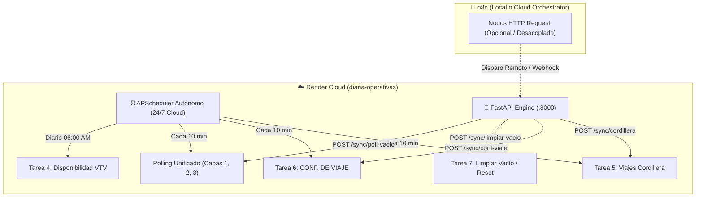

# 🚀 Logística Monorepo (Servicio Maestro Unificado en Render)

Monorepo centralizado para toda la infraestructura operativa, de sincronización y de visualización logística. Unifica el motor de **Hot RAM Cache (Node.js)**, **Sincronizaciones Operativas & Schedulers 24/7 (Python)** y los frontends (**DASH**, **Diagramas EOR** y **Pañol**) en una arquitectura orquestada y sincronizada con Render.

- **Servicio Maestro (Web Service Multi-Runtime):**  
  👉 **`srv-db4302u0tbcc73ctq4ng`** (`diaria-operativas` / `https://diaria-operativas.onrender.com`)
- **Servicio Satélite Pañol (Web Service Node.js):**  
  👉 **`srv-d9adns3eo5us739q897g`** (`panol-monolith-service` / `https://panolnd.onrender.com`)

---

## 📁 Estructura del Repositorio

```text
logistica-monorepo/
├── render.yaml                          <-- Blueprint orquestador de Render (Webs + Static Sites)
├── Dockerfile                           <-- Dockerfile raíz multi-stage (Node 20 + Python 3.11)
├── .env.example                         <-- Plantilla de variables de entorno maestras
│
├── services/
│   └── master-service/                  <-- Multi-Runtime Docker (Node 20 Gateway + Python 3.11 Engine)
│       ├── Dockerfile                   (Instala Node, Python, Uvicorn y librerías)
│       ├── start.sh                     (Script de inicio: Python en :8000 + Node.js en :10000)
│       ├── node_backend/                (Ex "sheet-render": Hot RAM, Socket.IO /dash, Pooler PG :6543)
│       └── python_engine/               (FastAPI, APScheduler 24/7, Sheets API, Telegram, Schedulers)
│
├── apps/
│   ├── dash-frontend/                   <-- React 19 + Vite (DASH Kanban y Tablero de Flota)
│   │   └── .env.production              (VITE_API_URL=https://diaria-operativas.onrender.com)
│   ├── eor-frontend/                    <-- React + Vite (Diagramas EOR y Planificación Diaria)
│   │   └── .env.production              (VITE_API_URL=https://diaria-operativas.onrender.com)
│   └── panol/                           <-- Backend Monolito y Frontend Vite de Pañol y Mantenimiento
│       ├── index.js                     (Express + PostgreSQL + Google Sheets para Pañol)
│       └── frontend/                    (Static site conectado a https://panolnd.onrender.com)
│
└── scripts/                             <-- Herramientas de desarrollo local y healthcheck
    ├── dev-backend.bat                  (Lanza localmente Node.js :3005 + Python :8000 en modo seguro)
    ├── dev-panol.bat                    (Lanza backend :5000 y frontend :5173 de Pañol localmente)
    ├── dev-backend-panol.bat            (Lanza Backend Maestro + Pañol en conjunto sin conflictos)
    ├── dev-dash.bat                     (Lanza frontend DASH en modo desarrollo)
    ├── dev-eor.bat                      (Lanza frontend EOR en modo desarrollo)
    └── test-health.ps1                  (Sonda de verificación de endpoints en producción)
```

---

## 🧠 Explicitación de `sheet-render` (Evolución y Rol en el Monorepo)

### ¿Qué era `sheet-render`?
En la arquitectura previa, **`sheet-render`** existía como un Web Service independiente en Render (`srv-dbdorkvavr4c738s3nbg`).  
Su misión primordial era actuar como puente reactivo entre la base de datos central en **Supabase (PostgreSQL)** y las interfaces web (**DASH**, **Diagramas EOR**), manteniendo una **Hot RAM Cache en memoria** de latencia ultrabaja (< 5ms) para resolver el consumo excesivo de cuotas de Egress y los timeouts de conexión directa a Supabase.

### Su integración en el Servicio Maestro:
En este monorepo unificado, **`sheet-render`** ha sido integrado como el componente **`services/master-service/node_backend`**:
1. **API Gateway Frontal (Puerto Público 10000):**  
   Recibe todo el tráfico entrante de los clientes web y del orquestador de Render.
2. **Motor de Hot RAM Cache:**  
   Almacena en memoria RAM las tablas de unidades, choferes, diagramas diarios, novedades y movimientos de kilómetros.
3. **Servidor WebSocket (Socket.IO):**  
   Gestiona la sincronización bidireccional en tiempo real del namespace `/dash`.
4. **Reverse Proxy a Python Engine (`127.0.0.1:8000`):**  
   Cualquier petición hacia `/sync/*` o `/status` es interceptada y redirigida internamente hacia el motor Python FastAPI, evitando exponer múltiples puertos o servicios públicos innecesarios.

> [!NOTE]  
> Esta consolidación permitió apagar y pausar la instancia separada `srv-dbdorkvavr4c738s3nbg` en Render, ahorrando recursos y eliminando discrepancias entre versiones de endpoints.

---

## ⚡ Partición del Workflow de n8n (Tareas 5, 6 y 7 Desplegadas en Render)

Originalmente, el circuito operativo dependía del canvas monolítico de n8n local (`operativas_diarias_diagrama.json` / `n8n_workflow_integrado_operativas.json`), el cual invocaba scripts vía comandos de shell (`Execute Command`) obligando a mantener una PC local encendida 24/7.

Las tareas clave fueron **particionadas, independizadas y migradas a Render Cloud** dentro de `services/master-service/python_engine`:



### Detalle de las tareas desplegadas:

| Tarea n8n | Nombre & Script | Despliegue en Render Cloud | Endpoint REST (Trigger / Webhook) |
| :--- | :--- | :--- | :--- |
| **Tarea 4** | **Pintar Disponibilidad**<br>`node pintarDisponibilidad.js` | Ejecución programada vía **APScheduler diario a las 06:00 AM**. Pinta estados de VTV y habilitaciones. | `POST /sync/dispo` |
| **Tarea 5** | **Viajes Cordillera ➡️ SEGURIDAD VIAL**<br>`main.py --seguridad-vial` | Ejecución autónoma vía **APScheduler cada 10 minutos** (`job_cordillera`). Extrae viajes de Ruteos hacia SEGURIDA VIAL. | `POST /sync/cordillera` |
| **Tarea 6** | **UTE Cordillera ➡️ CONF. DE VIAJE**<br>`main.py --conf-viaje` | Ejecución autónoma vía **APScheduler cada 10 minutos** (`job_conf_viaje`). Filtra viajes con alerta ⚠️ en Col F. | `POST /sync/conf-viaje` |
| **Tarea 7** | **Limpieza de VACÍO y Reset**<br>`limpiar_vacio.py --apply` | **Desplegada y lista en Render**. Mantenida exclusivamente con disparo bajo demanda para evitar limpiezas accidentales no supervisadas. | `POST /sync/limpiar-vacio`<br>*(Opcional: `?day=X`)* |
| **Motor Polling** | **Polling Inteligente en Capas**<br>`poll_sync_vacio.py --apply --borders` | Ejecución autónoma vía **APScheduler cada 10 minutos** (`job_poll_vacio`). Gatekeeper SHA-256 + Capas 1, 2 y 3. | `POST /sync/poll-vacio` |

> [!TIP]
> **Beneficio de la partición:** n8n queda liberado de la carga de ejecución pesada de scripts de consola de Windows. Ahora puede limitarse a orquestar mediante simples llamadas HTTP (`POST https://diaria-operativas.onrender.com/sync/...`) o delegar el 100% de la ejecución al scheduler cloud con alertas directas a Telegram.

---

## 🌐 Mapeo de Enrutamiento de URLs

| Origen | Endpoint Solicitado | Destino / Handler Interno |
| :--- | :--- | :--- |
| **DASH Frontend** (`dash-aa1f`) | `GET /api/dash/flota` | Node.js Hot RAM (1.1 MB comprimido a ~42 KB gzip) |
| **DASH Frontend** | `GET /api/dash/novedades` | Node.js Hot RAM |
| **DASH Frontend** | `GET /api/dash/terminales` | PostgreSQL directo (vía pooler Supabase :6543) |
| **DASH Frontend** | `GET /api/dash/tipos-novedad`| PostgreSQL directo (vía pooler Supabase :6543) |
| **DASH Frontend** | `WebSocket /socket.io` | Socket.IO Server (namespace `/dash`) |
| **Diagramas EOR** | `GET /api/datos` | Node.js Hot RAM (matriz diaria + KM) |
| **n8n / Triggers** | `POST /sync/cordillera` | Proxy interno a Python FastAPI (`127.0.0.1:8000`) |
| **n8n / Triggers** | `POST /sync/conf-viaje` | Proxy interno a Python FastAPI (`127.0.0.1:8000`) |
| **n8n / Triggers** | `POST /sync/limpiar-vacio`| Proxy interno a Python FastAPI (`127.0.0.1:8000`) |
| **n8n / Triggers** | `POST /sync/poll-vacio` | Proxy interno a Python FastAPI (`127.0.0.1:8000`) |
| **Keep-Alive (n8n / Render)** | `GET /health` | Node.js Gateway (devuelve `status: ok`) |
| **APScheduler** | Tareas 24/7 (Jobs 4, 5, 6, Polling) | Python Background Scheduler en segundo plano |

---

## 📦 Ubicación de Directorios Originales (Movidos al Vault)

Para mantener el espacio de trabajo limpio y prevenir ejecuciones accidentales en versiones desactualizadas, los proyectos y carpetas de código originales previos a la unificación monorepo fueron **archivados y resguardados en el Vault**:

📂 **Ruta de Resguardo:**  
`C:\Users\Matias Rodriguez\Documents\VAULT\archive_pre_monorepo_20261103\`

### Contenido archivado en el Vault:
- `dash/` ➔ Código fuente original de DASH Frontend.
- `eor_v1/` y `eor.ui/` ➔ Código fuente original del Frontend Diagramas EOR.
- `panol/` ➔ Versión previa del monolito de Pañol.
- `server_local/` ➔ Contenedor local previo con:
  - `operativas_diarias/` ➔ Motor Python previo.
  - `sheet-render/` ➔ Backend Node.js de Hot RAM previo.
- `storage_ram_db/` ➔ Versión previa del repositorio de RAM y base de datos.

### 🛡️ Guía de Rollback Garantizado
Si en algún momento se necesitara restaurar la infraestructura original independiente:
1. En el Dashboard de Render, reanudar los servicios pausados:
   - `srv-dbdorkvavr4c738s3nbg` (`sheet-render`).
   - `srv-dbfpnrl9fdbs739n5vvg` (`back dash`).
2. Restaurar la variable de entorno `VITE_API_URL` en los static sites hacia sus respectivos backends individuales.
3. Copiar las carpetas correspondientes desde `C:\Users\Matias Rodriguez\Documents\VAULT\archive_pre_monorepo_20261103\` a su ubicación original en `Documents`.
