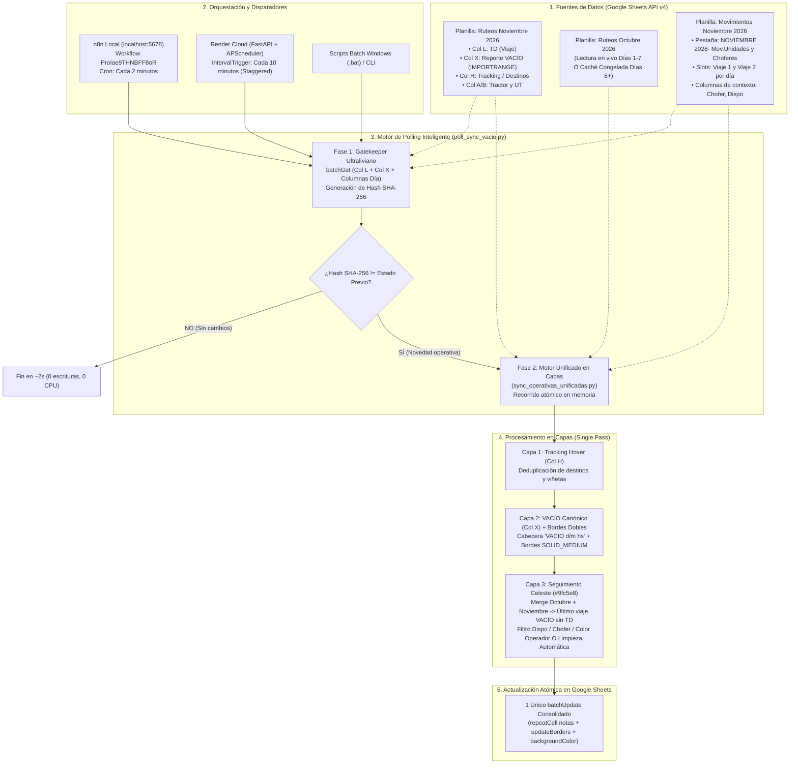

# 🚀 Motor Operativo Unificado: Polling Inteligente de Vacío, Ruteos & Movimientos

Repositorio centralizado del motor de sincronizaciones operativas, asignación en capas y orquestación híbrida (Local n8n + Render Cloud) integrado en el backend unificado:
📁 `C:\Users\Matias Rodriguez\Documents\logistica-monorepo\services\master-service\python_engine`

---

## 📑 Tabla de Contenidos
1. [Arquitectura del Motor en Capas y Diagrama de Flujo](#-arquitectura-del-motor-en-capas-y-diagrama-de-flujo)
2. [Motor de Polling Inteligente: Fase 1 (Gatekeeper) y Fase 2 (Merge)](#-motor-de-polling-inteligente-fase-1-gatekeeper-y-fase-2-merge)
3. [Lectura del Mes Anterior (UTE Octubre 2026) y Transición Dual](#-lectura-del-mes-anterior-ute-octubre-2026-y-transición-dual)
4. [Metodología para Conservar la Fidelidad de los Datos](#-metodología-para-conservar-la-fidelidad-de-los-datos)
5. [Periodicidad y Orquestación (n8n Local vs Render Cloud)](#-periodicidad-y-orquestación-n8n-local-vs-render-cloud)
6. [Corroboración del Workflow n8n (ProIae9THNBFF8oR)](#-corroboración-del-workflow-n8n-proiae9thnbff8or)
7. [Matriz Canónica de Tareas Operativas](#-matriz-canónica-de-tareas-operativas)
8. [Blindaje de Concurrencia y Auditoría (execution_shield.py)](#-blindaje-de-concurrencia-y-auditoría-execution_shieldpy)
9. [Guía de Comandos CLI y Scripts Batch (.bat)](#-guía-de-comandos-cli-y-scripts-batch-bat)

---

## 🌐 Arquitectura del Motor en Capas y Diagrama de Flujo

El motor unificado (`poll_sync_vacio.py` + `sync_operativas_unificadas.py`) consolida en una **única pasada en memoria** el procesamiento de las tareas operativas diarias, eliminando lecturas redundantes y ejecutando un solo `batchUpdate` atómico en Google Sheets.



---

## ⚡ Motor de Polling Inteligente: Fase 1 (Gatekeeper) y Fase 2 (Merge)

### Fase 1: Gatekeeper Ultraliviano (~2 a 3 segundos)
Para evitar saturar las cuotas de Google Sheets API (300 lecturas / 300 escrituras por minuto por proyecto) al consultar cada 2 minutos:
1. **Llamada de detección mínima:** Se realiza un solo `batchGet` solicitando exclusivamente:
   - `Ruteos!L4:L`: Columna de códigos de viaje (TDs).
   - `Ruteos!X4:X`: Columna de reportes de vacío.
   - `Movimientos!{ColChofer}3:{ColSlot2}350`: Columnas del día evaluado en Movimientos.
2. **Firma criptográfica (SHA-256):** Se serializa la estructura observada (cantidad de vacíos, últimos 150 TDs y celdas activas) y se calcula su hash SHA-256.
3. **Salida Abrupta Idempotente:** Si el hash es idéntico al registrado en [`last_poll_state.json`](./last_poll_state.json):
   - El proceso termina de inmediato con **código 0**.
   - **Consumo:** 2 peticiones HTTP de lectura, **cero (0) escrituras**, sin procesar los miles de filas históricas.

### Fase 2: Ejecución Unificada en Memoria
Si el Gatekeeper detecta modificaciones (o se pasa el flag `--force`):
1. Descarga el rango completo de Ruteos del mes (`A4:AL`).
2. Descarga el mes anterior (según la política de transición dual).
3. Obtiene en una consulta dirigida los tractores (Col E), números de UT (Col C) y las celdas de los días objetivo en Movimientos.
4. Ejecuta las **3 capas en un solo ciclo**, acumulando las solicitudes para enviarlas en **un único `batchUpdate`**.

---

## 📅 Lectura del Mes Anterior (UTE Octubre 2026) y Transición Dual

### ¿Por qué es mandatoria la lectura del mes anterior?
En la operación logística, los tractores realizan viajes de larga distancia y servicios de campo que abarcan varios días.
- Un tractor puede haber salido despachado el **30 o 31 de Octubre** y completar su descarga o quedar en estado **VACÍO** el **1, 2 o 3 de Noviembre**.
- Si el sistema evaluara únicamente la planilla de Noviembre, ese tractor aparecería como "sin viajes en el mes" o no se le detectaría el estado de vacío previo, perdiendo la trazabilidad operativa y omitiendo el pintado celeste `#9fc5e8`.
- Por ello, el motor reconstruye la **historia cronológica concatenada**:
  $$\text{Ruteos Total} = \text{Ruteos Octubre} + \text{Ruteos Noviembre}$$

### Metodología de Transición Dual (Días 1 a 7 vs Día 8+)

| Periodo del Mes | Condición de Código | Fuente de Datos de Octubre | Consumo de API Google | Justificación Operativa |
| :--- | :--- | :--- | :---: | :--- |
| **Días 1 a 7** *(Activo: 04/11)* | `self.day <= dias_transicion_dual` | **Lectura en vivo** a Ruteos Octubre (`1-wNLgr2...`) + actualización de caché local. | Normal (Lectura dual) | En la primera semana aún pueden cargarse novedades tardías o cierres de viajes de fin de mes. |
| **Día 8 en adelante** | `self.day > dias_transicion_dual` | **Caché congelada en disco** ([`cache_ruteos_mes_anterior.json`](./cache_ruteos_mes_anterior.json)). | **0 llamadas a API** (Cero cuota) | La planilla de Octubre ya está cerrada administrativamente. Se lee de disco en milisegundos. |

*Parámetro configurable:* `dias_transicion_lectura_dual` en [`config_operativas.json`](./config_operativas.json) (valor por defecto: `7`).

---

## 🎯 Metodología para Conservar la Fidelidad de los Datos

Para garantizar que el proceso automatizado **nunca corrompa, borre ni altere** la información introducida por los operadores humanos:

### 1. Inyección Exclusiva en Hover Notes (Sin tocar valores ni fórmulas)
- Los datos de tracking y los encabezados de vacío se escriben **únicamente en las notas emergentes (`cell.note`)** de la celda.
- El valor visible de la celda (`userEnteredValue`), las fórmulas existentes y los formatos de texto permanecen **100% inalterados**.

### 2. Regla Canónica de Columna X vs Columna H
- **Columna X = Fuente única y obligatoria de VACÍO:**
  - El encabezado `VACIO d/m hs` y los **bordes dobles** (`SOLID_MEDIUM` en parte inferior e izquierda) se aplican **estrictamente** si la Columna X de Ruteos contiene un reporte válido.
  - Formatos reconocidos: fechas con o sin hora (`08/10/2026`, `08/10 14:00`, `04/10 8:10 hs`, `VACIO`).
  - Descartes estrictos de falsos positivos: `FALSE`, `TRUE`, `#N/A`, `TLC`, `TPH`, `NO`, cadenas vacías.
- **Columna H = Tracking puro:**
  - Contiene destinos, números de remito, horarios de paso y novedades de chofer.
  - Sus textos se formatean con viñetas (`•`) y se insertan debajo del encabezado de vacío, **sin crear jamás un encabezado de vacío ni activar bordes dobles por sí mismos**.

### 3. Emparejamiento Seguro (Merge Virtual TD + Patente/UT)
- Nunca se mapean celdas por posición estática.
- Se indexan dinámicamente:
  - `tractor_to_row`: Patente normalizada (ej. `AE123CD`) -> Fila en Movimientos.
  - `ut_to_row`: Número de UT (ej. `123`, `123-C`) -> Fila en Movimientos.
- Manejo de Slots:
  - Si la unidad tiene 1 viaje en el día: se asigna al **Slot 1** (Columna de Viaje principal). Si el Slot 1 tiene valor manual pero el Slot 2 está disponible, se deriva al **Slot 2**.
  - Si la unidad tiene 2 viajes: se distribuyen en **Slot 1 y Slot 2** respectivamente.

### 4. Capa 3: Reglas de Seguimiento Celeste (`#9fc5e8`) y Protección de Operador
Para pintar una celda de celeste (indicando unidad disponible vacía):
- **Condición A:** El último viaje cronológico del tractor (considerando Octubre + Noviembre) tiene reporte de VACÍO en Col X y **NO posee ningún TD posterior asignado**.
- **Condición B (Standby):** La unidad no registra viajes en el mes analizado, pero tiene chofer asignado en Movimientos.
- **Protección de Colores Manuales del Operador:**
  - Si la celda ya tiene un color asignado manualmente por el despachante (amarillo, verde, violeta, naranja), el script **respeta el color del operador y no lo sobreescribe**.
- **Filtro de Localidades Excluidas (`Dispo`):**
  - No se pinta celeste si la columna `Dispo` contiene bases o talleres no operativos: `dock sud`, `tds`, `tlc`, `tlp`, `tvm`, `tlc-cm`, `tlc-ute`, `pp`.
- **Filtro de Choferes Excluidos:**
  - No se pinta si el chofer asignado contiene el carácter `'1'` (marca de desunión o franco).
- **Cleanup Automático Bidireccional:**
  - Si una celda estaba pintada de celeste y el tractor recibe un nuevo despacho (nuevo TD en Ruteos), o cambia su estado de disponibilidad/chofer, el script **remueve el color celeste automáticamente**, devolviendo el fondo a blanco base (`#ffffff`).

### 5. Idempotencia y Diffing O(1)
- Antes de enviar un cambio a Google Sheets, el motor compara:
  - `nueva_nota != nota_actual_en_hoja`
  - `nuevo_color != color_actual_en_hoja`
- Si no hay diferencias reales, la celda se omite del payload.

---

## ⏱️ Periodicidad y Orquestación (n8n Local vs Render Cloud)

| Entorno | Orquestador | Frecuencia de Polling | Modo de Ejecución | Comando / Endpoint |
| :--- | :--- | :---: | :--- | :--- |
| **Local (Producción Primaria)** | **n8n Local** (`http://localhost:5678`) | **Cada 2 minutos** | Cron programado (`*/2 * * * *`) | `cmd /c "cd /d ...\python_engine && py -3.13 poll_sync_vacio.py --apply --borders"` |
| **Cloud (Respaldo 24/7)** | **Render Cloud** (`server_render.py`) | **Cada 10 minutos** | APScheduler (Escalonado 5m offset) | `POST /sync/poll-vacio` (o job interno `job_poll_vacio`) |

---

## 🧩 Corroboración del Workflow n8n (`ProIae9THNBFF8oR`)

En la instancia local de n8n, el workflow **`Operativas Integradas - Cordillera, Movimientos & Disponibilidad (Cloud & Local)`** cuenta con 5 carriles de ejecución que apuntan al backend unificado:

| Carril / Tarea | Nodo Trigger en n8n | Nodo de Ejecución (`n8n-nodes-base.executeCommand`) | Comando Canónico Configurado |
| :--- | :--- | :--- | :--- |
| **Polling Vacío + Capas** | `⏰ Cron: Polling Unificado en Capas (Cada 2m)` | `Ejecutar Polling Inteligente VACIO + Seguimiento` | `cmd /c "cd /d C:\Users\Matias Rodriguez\Documents\logistica-monorepo\services\master-service\python_engine && py -3.13 poll_sync_vacio.py --apply --borders"` |
| **Disponibilidad VTV** | `⏰ Cron: Disponibilidad (Diario 06:00 AM)` | `Ejecutar Pintado de Disponibilidad` | `cmd /c "cd /d C:\Users\Matias Rodriguez\Documents\logistica-monorepo\services\master-service\python_engine && node pintarDisponibilidad.js"` |
| **Viajes Cordillera** | `⏰ Cron: Viajes Cordillera (Cada 10m)` | `Ejecutar Sync Viajes Cordillera` | `cmd /c "cd /d C:\Users\Matias Rodriguez\Documents\logistica-monorepo\services\master-service\python_engine && py -3.13 main.py --seguridad-vial"` |
| **CONF. DE VIAJE** | `⏰ Cron: CONF. DE VIAJE (Cada 10m)` | `Ejecutar Sync CONF. DE VIAJE` | `cmd /c "cd /d C:\Users\Matias Rodriguez\Documents\logistica-monorepo\services\master-service\python_engine && py -3.13 main.py --conf-viaje"` |
| **Limpieza VACÍO** | Disparador Manual Exclusivo | `Ejecutar Limpieza VACIO` | `cmd /c "cd /d C:\Users\Matias Rodriguez\Documents\logistica-monorepo\services\master-service\python_engine && py -3.13 limpiar_vacio.py --apply"` |

*Tanto la base de datos SQLite de n8n (`database.sqlite`) como los archivos canónicos [`operativas_diarias_diagrama.json`](../../../server_local/n8n/workflows/operativas_diarias_diagrama.json) y [`n8n_workflow_integrado_operativas.json`](./n8n_workflow_integrado_operativas.json) se encuentran 100% sincronizados.*

---

## 📋 Matriz Canónica de Tareas Operativas

| # | Tarea | Script | Frecuencia | Origen | Destino | Regla Principal |
|---|---|---|---|---|---|---|
| **1-3** | **Polling Vacío Unificado** | `poll_sync_vacio.py` | Cada 2m (Local) / 10m (Cloud) | Ruteos (Cols L, X, H) + Mes Anterior | Movimientos Mensual | Gatekeeper SHA-256 + 3 capas: Tracking, Vacío con bordes y Seguimiento celeste. |
| **4** | **Pintar Disponibilidad** | `pintarDisponibilidad.js` | Diario 07:00 AM (IDE) / 06:00 AM (Render/n8n) | `base datos Uni QM` + Drive `pintardispo.json` | 33 cols `Dispo.` Movimientos | Semáforo: Rojo (<0 d), Azul (<=10 d), Base (#F5F7FA). Diffing O(1) con tracking dual (estadoPrevio vs estadoActual). Protege 37 cabeceras de servicio. |
| **5** | **Viajes Cordillera** | `main.py --seguridad-vial` | Cada 10m | Ruteos (Col L y destinos) | Pestaña `SEGURIDA VIAL` | Sincroniza 22 columnas ordenadas por viaje TD si destino coincide con Cordillera. |
| **6** | **CONF. DE VIAJE** | `main.py --conf-viaje` | Cada 10m | `UTE Cordillera Noviembre 26` | `CONF. DE VIAJE NOVIEMBRE 26` | Copia filas desde fila 5 con símbolo ⚠️ en Col F (Marca Temp - Respuesta). |
| **7** | **Limpieza VACÍO (Reset)**| `limpiar_vacio.py` | Disparo manual | Movimientos Mensual | Movimientos Mensual | Limpieza administrativa de bordes y notas ante correcciones humanas. Preserva Col H. |

---

## 🛡️ Blindaje de Concurrencia y Auditoría (`execution_shield.py`)

1. **Exclusión Mutua a Nivel de Sistema Operativo (`.sync.lock`):**
   - Antes de iniciar, cualquier tarea crea un archivo `.sync.lock` con su PID y timestamp.
   - Si otro proceso o cron se dispara mientras la tarea corre, consulta la API nativa de Windows (`kernel32.OpenProcess`). Si el proceso sigue activo, aborta de inmediato con **código 0**:
     ```text
     [BLINDAJE] 🔒 Proceso en curso detectado: 'Polling Inteligente' (PID 17208).
     [BLINDAJE] 🛡️ Omitiendo ejecución actual para evitar superposición concurrente.
     [BLINDAJE] 🛡️ Salida limpia sin colisión.
     ```
   - Si el proceso previo murió de forma abrupta (*stale lock*), libera el bloqueo automáticamente y continúa.
2. **Generación de Informes de Auditoría (`reportes/`):**
   - Cada ejecución con cambios genera un reporte detallado en `reportes/reporte_YYYYMMDD_HHMMSS.md` y actualiza el último estado en `reportes/ULTIMO_REPORTE_POLLING.md`.

---

## 💻 Guía de Comandos CLI y Scripts Batch (.bat)

### Comandos de Terminal (PowerShell / CMD)

```bash
# 1. Chequeo rápido de cambios en Fase 1 (Gatekeeper) sin aplicar cambios
py -3.13 poll_sync_vacio.py --check-only

# 2. Ejecutar Polling Inteligente con bordes dobles y aplicación real
py -3.13 poll_sync_vacio.py --apply --borders

# 3. Forzar sincronización completa ignorando el hash previo
py -3.13 poll_sync_vacio.py --apply --borders --force

# 4. Sincronizar un día específico o rango de días
py -3.13 poll_sync_vacio.py --day 4 --apply --borders
py -3.13 poll_sync_vacio.py --days 1-4 --apply --borders

# 5. Ejecutar Pintado de Disponibilidad (VTV / Habilitaciones)
node pintarDisponibilidad.js

# 6. Ejecutar Viajes Cordillera hacia SEGURIDA VIAL
py -3.13 main.py --seguridad-vial

# 7. Ejecutar sincronización de CONF. DE VIAJE
py -3.13 main.py --conf-viaje
```

### Scripts de Acceso Rápido (.bat)
- [`run_poll_vacio.bat`](./run_poll_vacio.bat): Polling Inteligente con aplicación real y bordes.
- [`run_all_syncs.bat`](./run_all_syncs.bat): Suite completa de sincronizaciones.
- [`run_sync_dispo.bat`](./run_sync_dispo.bat): Pintado de disponibilidad de flota.
- [`run_sync_cordillera.bat`](./run_sync_cordillera.bat): Sincronizador de Cordillera.
- [`run_sync_conf_viaje.bat`](./run_sync_conf_viaje.bat): Sincronizador de Confirmación de Viajes.

---

## 📁 Persistencia Compartida en Google Drive y Caché Local (`drive_state_manager.py`)

Para permitir que el sistema funcione en **modo desatendido 24/7** tanto desde **n8n Local** (`http://localhost:5678`) como desde **Render Cloud** (FastAPI/APScheduler cuando la terminal del usuario esté inactiva), el estado de las celdas se centraliza en:

- **Carpeta de Google Drive:** [`ruteos reportes`](https://drive.google.com/drive/folders/18E_m8Ye5dp5xv2oCmYhEm8Ts7eeA7y8-) (Folder ID: `18E_m8Ye5dp5xv2oCmYhEm8Ts7eeA7y8-`).
- **Directorio de Caché Local:** `python_engine/cache_drive_states/`.

### Archivos Gestionados en Google Drive:
1. `estado_operativo_octubre_2026.json`: Estado congelado del mes anterior (~37 KB). Contiene el último TD y estado de vacío de los 211 tractores de Octubre. Carga en **0.5 ms** (cero llamadas de red para Octubre).
2. `estado_operativo_noviembre_2026.json`: Registro activo mensual de celdas con merge (~80 KB). Se actualiza periódicamente ante cambios.
3. `pintardispo.json`: Índice de vencimientos de flota y tracking dual de disponibilidad (`estadoPrevio` vs `estadoActual`). Gestionado automáticamente por [`driveDispoManager.js`](./driveDispoManager.js) y [`core.js`](./core.js).

### Estructura Canónica de Disponibilidad (`pintardispo.json`):
- **`indice_patentes`:** Guarda el catálogo indexado de `base datos Uni QM` (790 patentes) con sus fechas parseadas, fecha mínima y hash criptográfico MD5.
- **`filas`:** Tracking fila por fila de las 258 unidades diagramadas, conservando **ambos estados** (`estadoPrevio` y `estadoActual`) a lo largo de las 33 columnas de días (`'N'` Gris `#F5F7FA`, `'A'` Azul `#4285F4`, `'R'` Rojo `#FF4D4D`).
- **Diffing O(1) & Lotes Adaptativos:** Si no hay cambios en vencimientos ni asignaciones, el Gatekeeper finaliza con **0 llamadas de escritura**. Si cambian patentes, actualiza únicamente esas filas en lotes de 30 operaciones con 350ms de pausa para evitar errores 503/500 de Google API.

```json
{
  "metadata": {
    "spreadsheetId": "1z66kNDjMki1k9csQevuyhfz50dYoHrQro4wPj-Yt-hc",
    "totalPatentes": 790,
    "totalFilasDiagramadas": 258,
    "alertas": { "rojos": 1572, "azules": 500, "normales": 6442 }
  },
  "indice_patentes": {
    "AA266DV": {
      "patente": "AA266DV",
      "vencimientos": [1521514800000, 1531278000000],
      "vencimientoMinStr": "20/03/2018",
      "hash": "9791421309d365868eee8fc02bff44dd"
    }
  },
  "filas": {
    "4": {
      "fila": 4,
      "tractor": "AG674AQ",
      "semi": "AB882WY",
      "estadoPrevio": ["N", "N", "N", "..."],
      "estadoActual": ["N", "N", "N", "..."],
      "cambioDeVencimiento": false,
      "cambioDeEstado": false,
      "updatedAt": "2026-11-10T12:10:27.151Z"
    }
  }
}
```

### Automatización Programada desde el IDE:
Se encuentra configurada la tarea automática en `.gemini/config/sidecars/pintar-disponibilidad/sidecar.json`:
- **Disparador:** Diario a las 07:00 AM (`CRON_TZ=America/Argentina/Buenos_Aires 0 7 * * *`).
- **Ejecuta:** `node pintarDisponibilidad.js` de forma autónoma con reporte de verificación en chat.

### Estructura Canónica del Objeto JSON:
- Almacena **únicamente las celdas con merge activo** (sin filas vacías redundantes).
- Incluye el texto de **Columna H** (`tracking_text`) y su hash SHA-256 (`hash_nota`) para detección $O(1)$ de modificaciones por el despachante sin re-escanear la planilla.

```json
{
  "metadata": {
    "mes_nombre": "Noviembre 2026",
    "ultima_actualizacion": "2026-11-04T13:48:42.415011Z",
    "origen_escritura": "local_n8n",
    "total_celdas_activas": 45
  },
  "ultimo_estado_tractores": {
    "AH630JV": {
      "td": "1332474",
      "has_vacio": false,
      "vacio_header": "",
      "last_row": 205
    }
  },
  "celdas_merge": {
    "dia_4": {
      "BR205": {
        "fila": 205,
        "col_idx": 69,
        "slot": 1,
        "tractor": "AH630JV",
        "ut": "483",
        "td": "1332474",
        "vacio_header": "",
        "tracking_text": "10:06 HUDSON (04-11) 16:00 SAN VICENTE/13:20 CAÑUELAS/12:19 VILLARS",
        "borde_doble": false,
        "color_celeste": false,
        "hash_nota": "ff81892e5db58fe605e9efb230ae3a8e23a82e71f56efe2ee0ca222af1cc6f66"
      }
    }
  }
}
```

### Instrucción de Subida Inicial a Google Drive:
Debido a que las Cuentas de Servicio de Google (Service Accounts) tienen cuota de almacenamiento de 0 MB para crear archivos propios en unidades personales de Drive, los archivos mensuales generados localmente deben ser subidos o arrastrados **una sola vez** por el usuario propietario (`m.rodriguez@transer-nqn.com`) a la carpeta:
👉 [https://drive.google.com/drive/folders/18E_m8Ye5dp5xv2oCmYhEm8Ts7eeA7y8-](https://drive.google.com/drive/folders/18E_m8Ye5dp5xv2oCmYhEm8Ts7eeA7y8-)

Archivos a arrastrar:
- `cache_drive_states/estado_operativo_octubre_2026.json`
- `cache_drive_states/estado_operativo_noviembre_2026.json`

Una vez presentes en la carpeta con propiedad de `m.rodriguez@transer-nqn.com`, la Service Account cuenta con permiso `canModifyContent: True` para actualizarlos ilimitadamente mediante `drive.files().update()` desde n8n local y Render Cloud. Mientras tanto, la caché local en disco garantiza funcionamiento ininterrumpido.

---

*Motor Operativo Unificado © 2026 — Monorepo Logística Master Service.*
